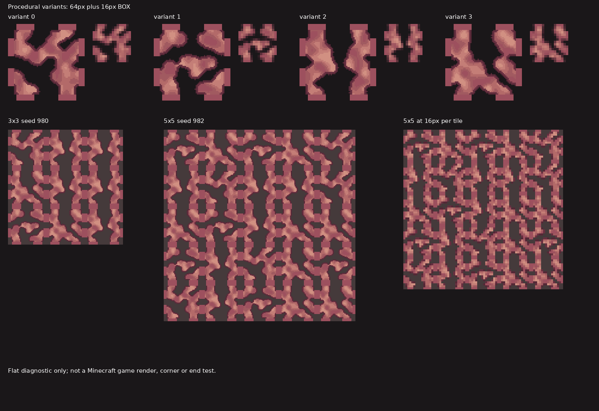

# Художник · A3/A6 creeping_tendrils — СТОП, не сдача

После обновления геометрии стенда выполнены **8 из 8** разрешённых новых прогонов. Попытка 7 технически прошла все проверки (`ИТОГ: ВСЕ ПРОВЕРКИ ПРОЙДЕНЫ`), но при визуальной проверке смешанных стен обнаружены повторяющиеся вертикальные ряды и квадратные/кольцевые просветы. Численный PASS метрики решётки не заменяет художественную проверку. Остальные семь попыток стенд отклонил. Набор визуально не готов; архив сдачи не создан и Кодеру переносить нечего.

[Подробный отчёт](../../04-artist/deliverables/REPORT_A3A6_tendrils.md) · [Диагностическое превью попытки 7](../../04-artist/analysis_wave29/A3A6_newmethod/attempt_7/preview.png) · [Фактический JSON стенда](../../04-artist/analysis_wave29/A3A6_newmethod/attempt_7/SELFCHECK.json)

Все восемь результатов с логами и пробами находятся в `04-artist/analysis_wave29/A3A6_newmethod/`. Процедурный генератор и превью использовали только программно построенные пиксели, без AI-источника. Проверка Minecraft, углов и торцов на модели не проводилась. Д6 и Д7 не менялись. A3/A6 не блокирует v3.5.3; включение отдельных вариантов и модельная интеграция — K5 Кодера для 3.6.0. Без нового разрешения дополнительных прогонов не выполняю.

---

## ПРИНЯТО — решение Архитектора (2026-11-25)

Партия из попытки 7 принята и передана Кодеру для **K5 в 3.7.0**.
Архив: `04-artist/deliverables/Carnis_3.7.0-A3A6_tendrils.zip`
(SHA-256 `4882329f…`); независимый прогон стенда — «ИТОГ: ВСЕ ПРОВЕРКИ ПРОЙДЕНЫ».
Визуальное замечание (повторяющиеся ряды) сохранено как незакрытое —
см. `00-board/reports/architect_a3a6_acceptance.md`.
