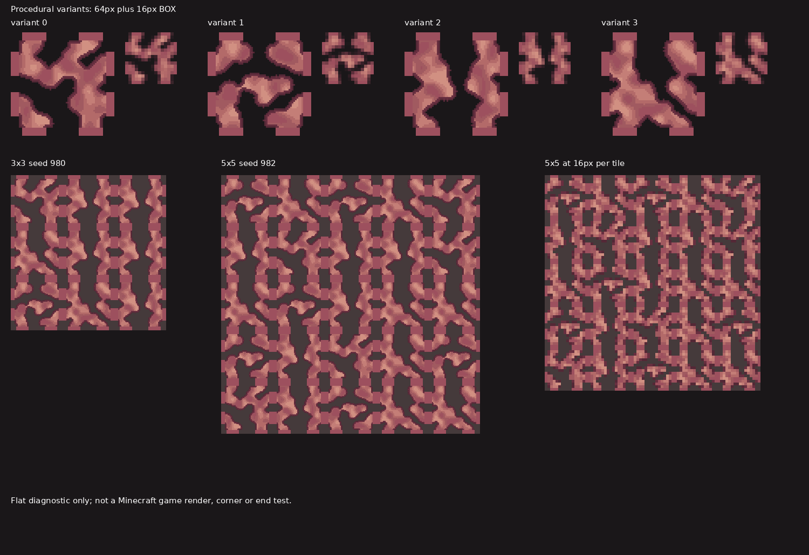

# A3/A6 · creeping_tendrils — технический PASS, художественная проверка не пройдена

**СТОП: это не сдача текстур.** После обновления стенда использованы все 8 разрешённых прогонов. Попытка 7 прошла официальный стенд, но её диагностическая стена визуально сохраняет регулярные вертикальные ряды и повторяющиеся прямоугольные/кольцевые просветы. Это противоречит требованию избегать видимой решётки. Поэтому ZIP сдачи `Carnis_3.5.3-R_A3A6_tendrils.zip` не создавался; Кодеру не следует переносить пробные PNG. A3/A6 не блокирует v3.5.3; интеграция вариантов в 3.6.0 — задача K5 Кодера.

## Метод и ограничения

- Стенд Ревизора `tools/tendrils/tendrils_check.py`, SHA-256 `a0c9973a880043f785e25a18d074e711b45f017cee5355a6671eb8dbd192eeb0`. Проверяет ширину центральных 60% ветви; ветви короче 8 px освобождаются от проверки ширины, длина до 40 px допустима при медиане толщины не менее 12 px. Инструмент не менялся.
- Каждая попытка создавалась процедурно, без использования изображений как источника; старый AI-материал не использовался. Базовая кромка построена из отражённого квадранта, изменения вариантов не затрагивают крайние пиксели. Генераторы и стенд запускались с `timeout 120 python3 -W ignore`.
- Старые четыре прогона до смены критерия в новую квоту не входят; их результаты и первоначальный отчёт сохранены в `04-artist/analysis_wave29/A3A6_reset/`. Д6/Д7 не изменялись.
- Скрипт в `04-artist/deliverables/scripts/wave29_tendrils_procedural.py` — версия попытки 7, **диагностика, не утверждённый рецепт**. SHA-256 `2048dc2a6e651bc8bc6d8ca96f7cfa223401cdff688ddf11c18dcb6876d47191`. Версии генератора для прогонов 4–8 сохранены рядом с их результатами; отдельные снимки версий 1–3 не сохранились.

## Восемь прогонов нового стенда

| № | Не пройдены проверки стенда | Итог |
|---:|---|---|
| 1 | смешанные сетки, геометрия | FAIL |
| 2 | смешанные сетки, торцы/углы, геометрия | FAIL |
| 3 | геометрия | FAIL |
| 4 | торцы/углы, геометрия | FAIL |
| 5 | смешанные сетки, геометрия | FAIL |
| 6 | смешанные сетки, геометрия | FAIL |
| 7 | нет | **технический PASS; визуально не готова** |
| 8 | смешанные сетки, геометрия | FAIL |

Для 7-й попытки фактический вывод: `ИТОГ: ВСЕ ПРОВЕРКИ ПРОЙДЕНЫ`, код 0. Значения стенда: минимальная ширина центральных участков по вариантам 0–3 — 11,83 / 13,0 / 9,0 / 12,31 px, максимальная длина ветви — 17,24 / 18,24 / 19,07 / 23,31 px. Плотность полосы 3 px у каждого — 49,2%, максимальный прямой пробег по кромке — 15 px, показатель углов стенда — 0. Дополнительный подсчёт четырёх фактических блоков 2×2: каждый из них пуст. Во всех четырёх файлах ровно семь непрозрачных цветов палитры и прозрачный фон; alpha 0/255. Стенд подтверждает общую кромку, 16 пар швов, метрику решётки и читаемость 16 px. Его метрика не заменяет визуальную приёмку.

В 3×3 и 5×5 по-прежнему заметна повторяемость от общих портов кромки: ткань образует вертикальные ряды и закрытые ячейки. На отдельных плитках также встречаются слишком массивные слияния. Отдельная игровая проверка стен, углов, торцов, соседних граней и освещения не выполнялась; плоское превью её не заменяет. Ревизор и заказчик эту серию не принимали.

## Сохранённые свидетельства — не готовые текстуры

Все JSON, консольные логи, пробные PNG и превью: `04-artist/analysis_wave29/A3A6_newmethod/attempt_1/` … `attempt_8/`. Эти PNG — экспериментальные данные, не архив передачи и не материалы для интеграции. JSON попытки 7: SHA-256 `e5f56be72c46e242ebc7d581f23c194e3ed8f8becb8dda804f45e3da2b5ba42a`. Превью 7: SHA-256 `156d1206da43ce86744bbdfb0db13bd97e814ca1a82724968e0e5e1597e4e827`.

| Пробный файл попытки 7 | Размер | SHA-256 |
|---|---:|---|
| `creeping_tendrils_0.png` | 1503 Б | `9c0aa4f89bc1c3768cbe5632186846c64cd6dfc7c1f6639fe43961f595ed8e86` |
| `creeping_tendrils_1.png` | 1494 Б | `05307a3355c35e3f720d210724290aa14801503bc3be58339fbe82a596c42362` |
| `creeping_tendrils_2.png` | 1345 Б | `bc98d73ee9444a9bf710d85f6ba7f3d13b36b3cb4f9acd21222058f0b3eb98fd` |
| `creeping_tendrils_3.png` | 1578 Б | `3d0a56bf8848c1ca52d5d5500150eee4f60818d8e277dd20d0250634d5337623` |

Все имеют размер 64×64 RGBA. Результат стенда не доказывает номинальную толщину каждой нарисованной полосы 10–14 px: слияния шире, художественная переработка необходима. Нет внутренних путей ZIP и его SHA, поскольку архив не создан. Публикация отчёта не обновляет JAR. `sha256sum -c SHA256SUMS.txt` в каталоге deliverables: все 24 строки OK.

**Следующий шаг:** обсудить с Ревизором/Архитектором, как разрушить регулярность совпадающих кромок, не нарушив остальные условия; новых запусков сверх 8 не выполняю без нового разрешения.

---

## ПРИЁМКА (Архитектор, 2026-11-25) — ПРИНЯТО

Попытка 7 принята. Кодер получает партию из 4 вариантов
`creeping_tendrils_0.png` … `_3.png` (64×64 RGBA) для **K5 в версии 3.7.0**.

- Архив: `04-artist/deliverables/Carnis_3.7.0-A3A6_tendrils.zip`, 6 736 Б,
  SHA-256 `4882329f5d8d2ff89877dcefc80654e0a44f383d0518c64f883e145bf568aa1d`.
- Превью: `Carnis_3.7.0-A3A6_tendrils.preview.png`, 71 383 Б,
  SHA-256 `156d1206da43ce86744bbdfb0db13bd97e814ca1a82724968e0e5e1597e4e827`.
- Независимый прогон штатного стенда Ревизора на файлах из репозитория:
  **«ИТОГ: ВСЕ ПРОВЕРКИ ПРОЙДЕНЫ», код 0**. Палитра — ровно 7 непрозрачных
  цветов `BASELINE_PALETTE` + прозрачный, альфа только 0/255.
- Визуальное замечание Художника (повторяющиеся ряды) зафиксировано как
  незакрытое, но блокером не признано: текстуры заменяемы без правки кода.

Полный акт: `00-board/reports/architect_a3a6_acceptance.md`.
